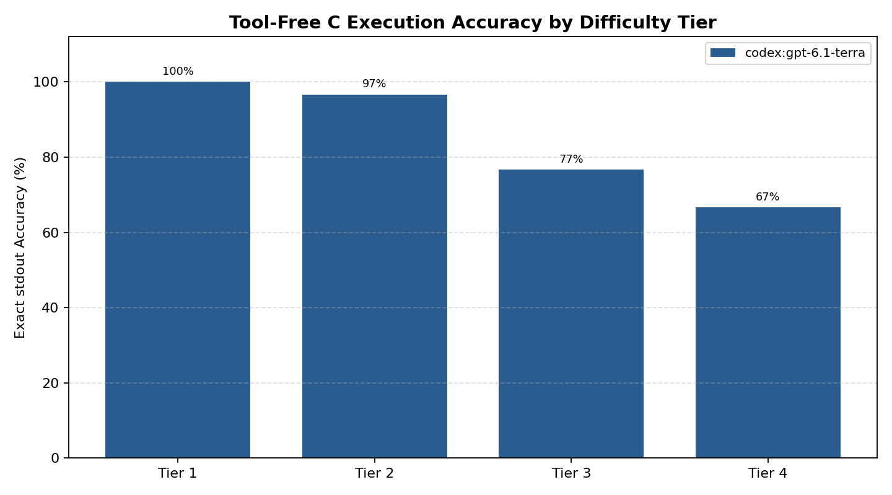
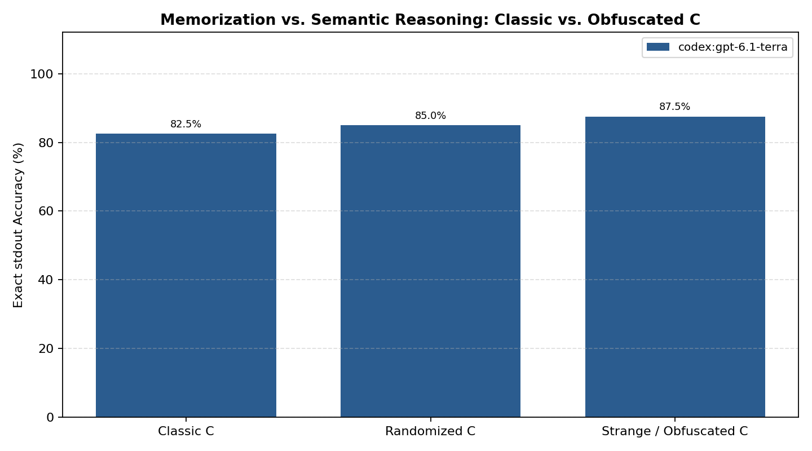
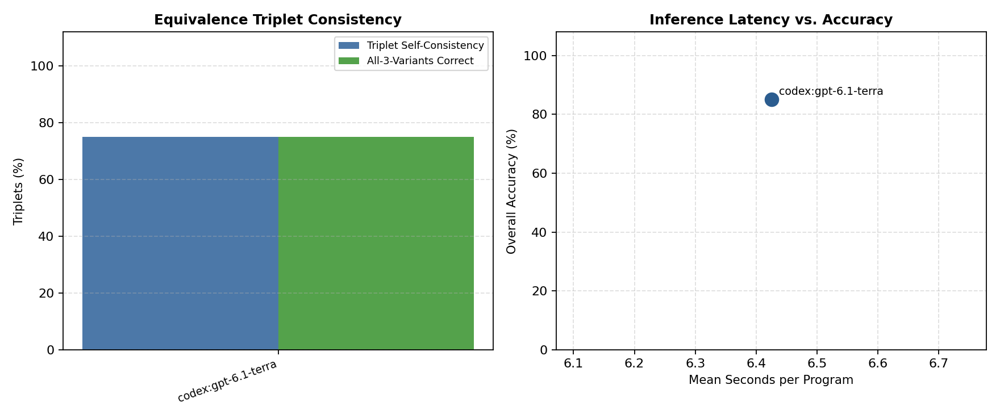

# Tool-Free C Program Execution Benchmark Report

## 1. Methodology Overview
- **Task:** Predict exact `stdout` of self-contained ANSI C11 programs without compiler, interpreter, or shell access.
- **Semantic Equivalence Triplets:** Every problem is evaluated across three provably equivalent implementations (`classic_c`, `randomized_c`, `strange_c`) verified under `gcc -O0` and `clang -O2` with `-fsanitize=undefined,address`.

## 2. Summary Leaderboard

| Model | Overall Acc | Classic C | Randomized C | Strange C | Style Drop (Classic - Strange) | Triplet Consistency | All-3 Correct | Mean Latency | Tool Violations |
| :--- | :---: | :---: | :---: | :---: | :---: | :---: | :---: | :---: | :---: |
| **codex:gpt-6.1-terra** | 85.0% | 82.5% | 85.0% | 87.5% | -5.0% | 75.0% | 75.0% | 6.42s | 0 |

## 3. Accuracy Across Difficulty Tiers

| Model | Tier 1 (Scalar) | Tier 2 (Arrays/Nested) | Tier 3 (Pointers/Bitwise) | Tier 4 (Invariants/Cycles) |
| :--- | :---: | :---: | :---: | :---: |
| **codex:gpt-6.1-terra** | 100.0% | 96.7% | 76.7% | 66.7% |

## 4. Visual Analysis

### Accuracy by Difficulty Tier

### Surface Pattern Matching vs. Deep Semantic Tracking

### Triplet Self-Consistency & Reasoning Latency

